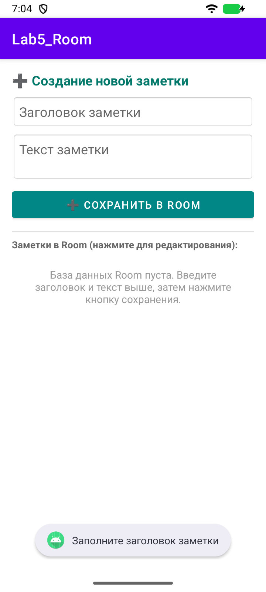
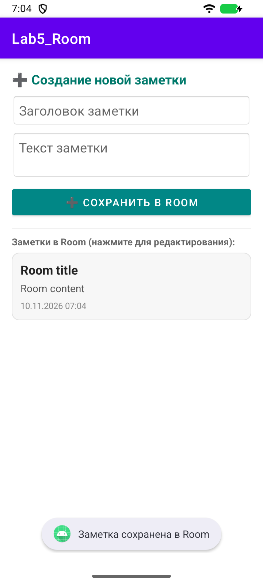
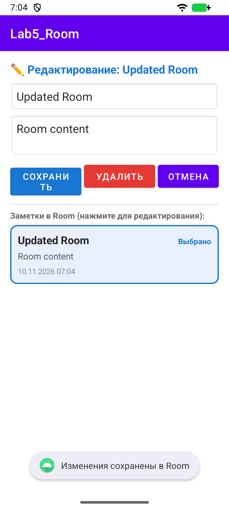
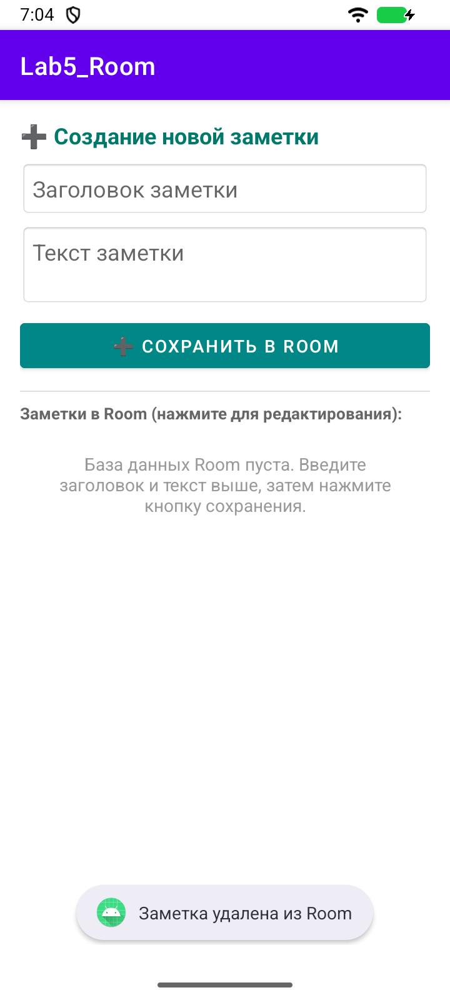

# Лабораторная работа 5

## SQLite через Room

Студент: Ретунский Савелий. Проверка: 10 ноября 2026 года.

## Цель

Реализовать сущность, DAO, RoomDatabase, ViewModel и наблюдаемый список заметок.

## Структура

MainActivity → NoteViewModel → suspend DAO → Room / SQLite → LiveData<List<Note>> → observe(Activity) → NotesAdapter → RecyclerView.

## Реализация и исправления

1. Note помечена @Entity(tableName = "notes") и содержит автогенерируемый @PrimaryKey id, title, content, timestamp.

2. NoteDao содержит @Insert, @Update, @Delete и @Query. getAllNotes возвращает LiveData<List<Note>>; suspend CRUD выполняется Room вне главного потока.

3. AppDatabase наследует RoomDatabase, регистрирует Note и использует applicationContext. Создание singleton повторно проверяет INSTANCE внутри synchronized.

4. ViewModel запускает операции в viewModelScope. Добавлены обработка ошибок SQLite, проверка результата DAO и блокировка кнопок на время записи. Сообщение об успехе появляется после завершения DAO; при ошибке поля остаются заполненными.

5. Выбор карточки подставляет данные в поля; обновление и удаление идут по ID. Заголовок не может быть пустым. При повороте сохраняется режим редактирования.

## Проверка

Сборка `assembleDebug assembleDebugAndroidTest lintDebug`: успешно. Android Lint: 0 ошибок, 47 предупреждений. Предупреждения включают строки в XML вместо ресурсов, локализацию и рекомендации по зависимостям; они не скрыты baseline-файлом.

Эмулятор: Medium Phone, Android 16 API 36.1, x86_64. Тест `LabRegressionTest`: пройден. Исходник теста: [LabRegressionTest.kt](../app/src/androidTest/java/com/example/lab5_room/LabRegressionTest.kt).

`connectedDebugAndroidTest` в этой Windows-среде не запустил Gradle Worker (`GradleWorkerMain` не найден). Те же собранные тестовые APK запускались через `adb shell am instrument -w …/androidx.test.runner.AndroidJUnitRunner`. Для повторения: `./verify.ps1 -DeviceTests` на отдельном эмуляторе. Скрипт очищает учебные данные приложения на эмуляторе.

Лог запуска:

```text
com.example.lab5_room.LabRegressionTest:.

Time: 27.36

OK (1 test)
```

## Скриншоты сценариев

### 01-empty-title



### 02-inserted



### 03-updated



### 04-deleted



## Фрагменты кода

### Note.kt

[Полный исходник](../app/src/main/java/com/example/lab5_room/Note.kt)

```kotlin
@Entity(tableName = "notes")
data class Note(
    @PrimaryKey(autoGenerate = true)
    val id: Int = 0,
    val title: String,
    val content: String,
    val timestamp: Long = System.currentTimeMillis()
)
```

### NoteDao.kt

[Полный исходник](../app/src/main/java/com/example/lab5_room/NoteDao.kt)

```kotlin
@Dao
interface NoteDao {

    @Insert
    suspend fun insert(note: Note): Long

    @Update
    suspend fun update(note: Note): Int

    @Delete
    suspend fun delete(note: Note): Int

    @Query("SELECT * FROM notes ORDER BY timestamp DESC")
    fun getAllNotes(): LiveData<List<Note>>
}
```

### AppDatabase.kt

[Полный исходник](../app/src/main/java/com/example/lab5_room/AppDatabase.kt)

```kotlin
@Database(entities = [Note::class], version = 1, exportSchema = false)
abstract class AppDatabase : RoomDatabase() {

    abstract fun noteDao(): NoteDao

    companion object {
        @Volatile
        private var INSTANCE: AppDatabase? = null

        fun getDatabase(context: Context): AppDatabase {
            return INSTANCE ?: synchronized(this) {
                INSTANCE ?: Room.databaseBuilder(
                    context.applicationContext,
                    AppDatabase::class.java,
                    "notes_room_database"
                ).build().also { INSTANCE = it }
            }
        }
    }
}
```

### NoteViewModel.kt

[Полный исходник](../app/src/main/java/com/example/lab5_room/NoteViewModel.kt)

```kotlin
class NoteViewModel(application: Application) : AndroidViewModel(application) {
    private val dao = AppDatabase.getDatabase(application).noteDao()
    val allNotes: LiveData<List<Note>> = dao.getAllNotes()
    private val _busy = MutableLiveData(false)
    val busy: LiveData<Boolean> = _busy
    private val _result = MutableLiveData<Pair<Boolean, String>?>(null)
    val result: LiveData<Pair<Boolean, String>?> = _result

    fun clearResult() { _result.value = null }
    private fun execute(message: String, operation: suspend () -> Boolean) {
        if (_busy.value == true) return
        _busy.value = true
        viewModelScope.launch {
            try {
                val success = operation()
                _result.value = success to if (success) message else "Запись не найдена или не сохранена"
            } catch (error: SQLiteException) {
                _result.value = false to "Ошибка базы данных: ${error.localizedMessage}"
            } finally {
                _busy.value = false
            }
        }
    }
    fun insert(note: Note) = execute("Заметка сохранена в Room") { dao.insert(note) != -1L }
    fun update(note: Note) = execute("Изменения сохранены в Room") { dao.update(note) > 0 }
    fun delete(note: Note) = execute("Заметка удалена из Room") { dao.delete(note) > 0 }
}
```

## Вывод

Room — рекомендуемая абстракция над штатной SQLite: проверяет SQL при компиляции, генерирует привязку объектов, уменьшает шаблонный код и интегрируется с LiveData/корутинами. Room поддерживает миграции, но конкретные миграции для следующих версий схемы разработчик должен описать отдельно. В этой работе схема имеет версию 1.
